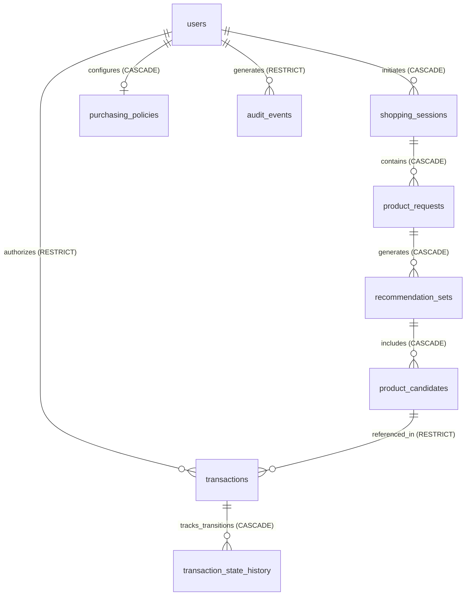

# Data Model & Storage Design: Acquira AI Shopping Agent

**Feature Directory**: `specs/001-ai-shopping-agent`  
**Date**: 2026-11-01  
**Database**: PostgreSQL 16 with Drizzle ORM  
**Revision**: 1.4.0 (Resolution of Circular FK: Canonical 1-to-1 payments.transaction_id, Removed transactions.payment_id, CBDC Deferral)  

---

## 1. Entity Relationship Diagram

---

## 2. PostgreSQL Relational Schemas

### `users`
Represents registered shopping consumers.

| Column | Type | Constraints | Description |
| :--- | :--- | :--- | :--- |
| `id` | `UUID` | `PRIMARY KEY DEFAULT gen_random_uuid()` | Unique user identifier |
| `email` | `VARCHAR(255)` | `UNIQUE NOT NULL` | Verified user email |
| `name` | `VARCHAR(255)` | `NOT NULL` | Display name |
| `password_hash` | `VARCHAR(255)` | `NOT NULL` | Secure bcrypt/argon2 hash |
| `is_anonymized` | `BOOLEAN` | `NOT NULL DEFAULT FALSE` | Flagged when personal data is scrubbed upon account deletion |
| `created_at` | `TIMESTAMPTZ` | `NOT NULL DEFAULT NOW()` | Account creation timestamp |
| `updated_at` | `TIMESTAMPTZ` | `NOT NULL DEFAULT NOW()` | Profile update timestamp |
| `deleted_at` | `TIMESTAMPTZ` | `NULL` | Soft-delete / deletion request timestamp |

---

### `purchasing_policies`
Configuration for user preferences, autonomous purchasing gates, and price thresholds.

| Column | Type | Constraints | Description |
| :--- | :--- | :--- | :--- |
| `id` | `UUID` | `PRIMARY KEY DEFAULT gen_random_uuid()` | Policy record identifier |
| `user_id` | `UUID` | `NOT NULL UNIQUE REFERENCES users(id) ON DELETE CASCADE` | 1-to-1 relationship with user |
| `is_autonomous_enabled` | `BOOLEAN` | `NOT NULL DEFAULT FALSE` | Flag enabling bounded-autonomous mode |
| `per_order_limit_inr` | `NUMERIC(12, 2)` | `NULL CHECK (per_order_limit_inr > 0)` | **Mandatory** limit before autonomous mode can be active |
| `cumulative_period_type` | `VARCHAR(20)` | `NULL CHECK (cumulative_period_type IN ('DAILY', 'WEEKLY', 'MONTHLY'))` | Optional period budget window |
| `cumulative_period_limit_inr` | `NUMERIC(12, 2)` | `NULL CHECK (cumulative_period_limit_inr > 0)` | **Optional** cumulative period limit (Option B) |
| `price_change_percentage_threshold` | `NUMERIC(5, 2)` | `NULL CHECK (price_change_percentage_threshold >= 0)` | **Mandatory** decrease threshold (e.g., 5.00 for 5%) |
| `price_change_absolute_threshold_inr` | `NUMERIC(10, 2)` | `NULL CHECK (price_change_absolute_threshold_inr >= 0)` | **Mandatory** decrease threshold (e.g., 100.00 for ₹100) |
| `approved_categories` | `JSONB` | `NOT NULL DEFAULT '[]'::jsonb` | Array of category slugs permitted for autonomous buys |
| `approved_marketplaces` | `JSONB` | `NOT NULL DEFAULT '[]'::jsonb` | Array of provider identifiers permitted |
| `seller_constraints` | `JSONB` | `NOT NULL DEFAULT '{}'::jsonb` | Rules: min_seller_rating, excluded_seller_ids |
| `preferred_payment_methods` | `JSONB` | `NOT NULL DEFAULT '[]'::jsonb` | Preferred payment methods (e.g., UPI, NetBanking) |
| `updated_at` | `TIMESTAMPTZ` | `NOT NULL DEFAULT NOW()` | Last modification timestamp |

---

### `shopping_sessions`
Conversational chat and discovery context.

| Column | Type | Constraints | Description |
| :--- | :--- | :--- | :--- |
| `id` | `UUID` | `PRIMARY KEY DEFAULT gen_random_uuid()` | Session identifier |
| `user_id` | `UUID` | `NOT NULL REFERENCES users(id) ON DELETE CASCADE` | Session owner |
| `title` | `VARCHAR(255)` | `NOT NULL` | Session title (e.g., "Laptop for college") |
| `created_at` | `TIMESTAMPTZ` | `NOT NULL DEFAULT NOW()` | Session start |
| `updated_at` | `TIMESTAMPTZ` | `NOT NULL DEFAULT NOW()` | Last message timestamp |

---

### `product_requests`
Extracted structured requirements from natural language conversation.

| Column | Type | Constraints | Description |
| :--- | :--- | :--- | :--- |
| `id` | `UUID` | `PRIMARY KEY DEFAULT gen_random_uuid()` | Request identifier |
| `session_id` | `UUID` | `NOT NULL REFERENCES shopping_sessions(id) ON DELETE CASCADE` | Associated session |
| `raw_query` | `TEXT` | `NOT NULL` | User's natural language input (English or Hinglish) |
| `extracted_category` | `VARCHAR(100)` | `NOT NULL` | Normalized category slug |
| `extracted_budget_max_inr`| `NUMERIC(12, 2)` | `NULL` | Budget ceiling if specified |
| `extracted_specifications`| `JSONB` | `NOT NULL DEFAULT '{}'::jsonb` | Structured specifications (e.g., {"ram": "16GB"}) |
| `user_preferences` | `JSONB` | `NOT NULL DEFAULT '{}'::jsonb` | Session-specific preferences |
| `is_resolved` | `BOOLEAN` | `NOT NULL DEFAULT FALSE` | True if requirements are sufficient for search |
| `created_at` | `TIMESTAMPTZ` | `NOT NULL DEFAULT NOW()` | Creation timestamp |

---

### `recommendation_sets`
A ranked recommendation bundle produced for a product request.

| Column | Type | Constraints | Description |
| :--- | :--- | :--- | :--- |
| `id` | `UUID` | `PRIMARY KEY DEFAULT gen_random_uuid()` | Recommendation set identifier |
| `request_id` | `UUID` | `NOT NULL REFERENCES product_requests(id) ON DELETE CASCADE` | Associated request |
| `ranking_rationale` | `TEXT` | `NOT NULL` | Plain-language explanation of primary factors |
| `trade_offs_summary`| `TEXT` | `NOT NULL` | Plain-language trade-offs among options |
| `data_quality_disclosures` | `JSONB` | `NOT NULL DEFAULT '[]'::jsonb` | Disclosures of missing/estimated data across set |
| `data_freshness_at` | `TIMESTAMPTZ` | `NOT NULL` | Timestamp when candidate data was retrieved |
| `is_stale` | `BOOLEAN` | `NOT NULL DEFAULT FALSE` | Flagged if data exceeded staleness threshold |
| `created_at` | `TIMESTAMPTZ` | `NOT NULL DEFAULT NOW()` | Generation timestamp |

---

### `product_candidates`
Individual normalized offers discovered from verified marketplace providers. Includes explicit itemized cost components.

| Column | Type | Constraints | Description |
| :--- | :--- | :--- | :--- |
| `id` | `UUID` | `PRIMARY KEY DEFAULT gen_random_uuid()` | Candidate identifier |
| `recommendation_set_id`| `UUID` | `NOT NULL REFERENCES recommendation_sets(id) ON DELETE CASCADE` | Set parent |
| `provider_id` | `VARCHAR(50)` | `NOT NULL` | Source provider (e.g., 'amazon_in', 'flipkart') |
| `provider_item_id` | `VARCHAR(255)` | `NOT NULL` | Provider's catalog identifier (ASIN, FSN) |
| `canonical_seller_id` | `VARCHAR(100)` | `NOT NULL` | Canonical seller identifier (distinct from display name) |
| `canonical_variant_sku`| `VARCHAR(100)` | `NOT NULL` | Canonical variant/SKU identifier (distinct from title) |
| `product_title` | `VARCHAR(500)` | `NOT NULL` | Cleaned product name |
| `product_url` | `TEXT` | `NOT NULL` | Canonical product URL |
| `seller_name` | `VARCHAR(255)` | `NOT NULL` | Merchant / Seller display name |
| `seller_rating` | `NUMERIC(3, 2)` | `NULL` | Seller score (e.g., 4.50 out of 5.0) |
| `base_price_inr` | `NUMERIC(12, 2)` | `NOT NULL` | Base product price (must be known) |
| `shipping_cost_inr` | `NUMERIC(10, 2)` | `NULL` | Shipping amount (NULL if UNAVAILABLE) |
| `shipping_status` | `VARCHAR(20)` | `NOT NULL DEFAULT 'KNOWN' CHECK (shipping_status IN ('KNOWN', 'ESTIMATED', 'UNAVAILABLE'))` | Availability status |
| `estimated_taxes_inr`| `NUMERIC(10, 2)` | `NULL` | Applicable taxes/GST (NULL if UNAVAILABLE) |
| `taxes_status` | `VARCHAR(20)` | `NOT NULL DEFAULT 'KNOWN' CHECK (taxes_status IN ('KNOWN', 'ESTIMATED', 'UNAVAILABLE'))` | Availability status |
| `platform_fees_inr` | `NUMERIC(10, 2)` | `NULL` | Explicit platform/convenience fee (NULL if UNAVAILABLE) |
| `platform_fees_status`| `VARCHAR(20)` | `NOT NULL DEFAULT 'KNOWN' CHECK (platform_fees_status IN ('KNOWN', 'ESTIMATED', 'UNAVAILABLE'))` | Availability status |
| `total_payable_inr` | `NUMERIC(12, 2)` | `NOT NULL` | Calculated sum of known/estimated components (lower bound if incomplete) |
| `has_unavailable_costs`| `BOOLEAN` | `NOT NULL DEFAULT FALSE` | True if shipping, taxes, or platform_fees is UNAVAILABLE |
| `cost_disclosures` | `JSONB` | `NOT NULL DEFAULT '[]'::jsonb` | Plain-language disclosures of estimated or missing costs |
| `rank_position` | `INTEGER` | `NOT NULL` | 1-based rank in recommendation set |
| `is_recommended` | `BOOLEAN` | `NOT NULL DEFAULT FALSE` | True for the top-recommended choice |
| `specifications` | `JSONB` | `NOT NULL DEFAULT '{}'::jsonb` | Normalized technical specifications |
| `created_at` | `TIMESTAMPTZ` | `NOT NULL DEFAULT NOW()` | Creation timestamp |

---

### `transactions`
The stateful **Order Execution** entity enforcing deterministic financial safety and order placement lifecycle.

| Column | Type | Constraints | Description |
| :--- | :--- | :--- | :--- |
| `id` | `UUID` | `PRIMARY KEY DEFAULT gen_random_uuid()` | Transaction identifier |
| `user_id` | `UUID` | `NOT NULL REFERENCES users(id) ON DELETE RESTRICT` | User who authorized purchase (RESTRICT prevents accidental deletion of financial records) |
| `candidate_id` | `UUID` | `NOT NULL REFERENCES product_candidates(id) ON DELETE RESTRICT` | Referenced offer candidate |
| `purchase_mode` | `VARCHAR(30)` | `NOT NULL CHECK (purchase_mode IN ('APPROVAL_BASED', 'BOUNDED_AUTONOMOUS'))` | Operating mode |
| `order_execution_mode` | `VARCHAR(30)` | `NOT NULL CHECK (order_execution_mode IN ('SIMULATED', 'LIVE_PROVIDER', 'MANUAL_HANDOFF'))` | Execution mode (must match payment mode; SIMULATED never authorizes LIVE) |
| `status` | `VARCHAR(30)` | `NOT NULL CHECK (status IN ('PENDING', 'SUBMITTED', 'CONFIRMED', 'FAILED', 'TIMED_OUT', 'UNCERTAIN'))` | Authoritative order state machine status |
| `canonical_seller_id` | `VARCHAR(100)` | `NOT NULL` | Snapshot of seller identifier at authorization |
| `canonical_variant_sku`| `VARCHAR(100)` | `NOT NULL` | Snapshot of variant SKU at authorization |
| `quantity` | `INTEGER` | `NOT NULL DEFAULT 1 CHECK (quantity > 0)` | Authorized order quantity |
| `authorized_baseline_inr`| `NUMERIC(12, 2)` | `NOT NULL` | Price baseline (confirmed summary total or evaluated total) |
| `authorized_fingerprint` | `VARCHAR(64)` | `NOT NULL` | SHA-256 lowercase hex digest of canonical serialization payload: `${encodeURIComponent(provider_id.trim())}:${encodeURIComponent(canonical_seller_id.trim())}:${encodeURIComponent(canonical_variant_sku.trim())}:${quantity}` |
| `final_charged_amount_inr`| `NUMERIC(12, 2)` | `NULL` | Authoritative amount charged at checkout |
| `idempotency_key` | `VARCHAR(100)` | `NOT NULL UNIQUE` | Idempotency token for external order dispatch |
| `provider_order_id` | `VARCHAR(255)` | `NULL` | Authoritative confirmation ID from marketplace (prefixed `DEMO-ORDER-` if SIMULATED) |
| `is_demo_order` | `BOOLEAN` | `NOT NULL DEFAULT FALSE` | True if order is simulated (no physical goods dispatched) |
| `failure_reason` | `TEXT` | `NULL` | Human-readable explanation if failed, timed out, or uncertain |
| `reconciliation_attempts` | `INTEGER` | `NOT NULL DEFAULT 0` | Counter for timeout reconciliation retries |
| `last_reconciled_at` | `TIMESTAMPTZ` | `NULL` | Timestamp of latest reconciliation status check |
| `created_at` | `TIMESTAMPTZ` | `NOT NULL DEFAULT NOW()` | Transaction initiation timestamp |
| `updated_at` | `TIMESTAMPTZ` | `NOT NULL DEFAULT NOW()` | Last state transition timestamp |

---

### `payments`
The stateful **Payment Execution** entity enforcing independent monetary authorization, capture, and reconciliation.

| Column | Type | Constraints | Description |
| :--- | :--- | :--- | :--- |
| `id` | `UUID` | `PRIMARY KEY DEFAULT gen_random_uuid()` | Payment record identifier |
| `transaction_id` | `UUID` | `NOT NULL UNIQUE REFERENCES transactions(id) ON DELETE RESTRICT` | Associated order transaction (enforces 1-to-1 canonical relationship; eliminates circular FK) |
| `user_id` | `UUID` | `NOT NULL REFERENCES users(id) ON DELETE RESTRICT` | Payer user identifier |
| `payment_execution_mode` | `VARCHAR(30)` | `NOT NULL CHECK (payment_execution_mode IN ('SIMULATED', 'LIVE_PROVIDER', 'MANUAL_HANDOFF'))` | Execution mode (SIMULATED moves zero real money) |
| `payment_method` | `VARCHAR(50)` | `NOT NULL CHECK (payment_method IN ('UPI_PHONEPE', 'AMAZON_PAY', 'MOCK_SANDBOX'))` | Payment instrument type (active MVP methods; CBDC deferred to future extension per Constitution A-004) |
| `provider_id` | `VARCHAR(50)` | `NOT NULL` | Gateway identifier (e.g. 'mock_payment_gateway', prospective 'phonepe_pg', prospective 'amazon_pay') |
| `status` | `VARCHAR(30)` | `NOT NULL CHECK (status IN ('INITIATED', 'PENDING', 'AUTHORIZED', 'CAPTURED', 'FAILED', 'UNCERTAIN'))` | Authoritative payment status |
| `amount_inr` | `NUMERIC(12, 2)` | `NOT NULL CHECK (amount_inr > 0)` | Payment amount in INR |
| `currency` | `VARCHAR(3)` | `NOT NULL DEFAULT 'INR'` | ISO 4217 currency code |
| `idempotency_key` | `VARCHAR(100)` | `NOT NULL UNIQUE` | Idempotency token for payment gateway dispatch |
| `provider_payment_id` | `VARCHAR(255)` | `NULL` | External or synthetic reference (e.g. 'DEMO-RECEIPT-UUID' for SIMULATED) |
| `is_demo_receipt` | `BOOLEAN` | `NOT NULL DEFAULT FALSE` | True if generated by mock payment gateway |
| `failure_reason` | `TEXT` | `NULL` | Gateway decline reason or error message |
| `reconciliation_attempts` | `INTEGER` | `NOT NULL DEFAULT 0` | Counter for ambiguous payment reconciliation retries |
| `last_reconciled_at` | `TIMESTAMPTZ` | `NULL` | Timestamp of latest payment reconciliation check |
| `created_at` | `TIMESTAMPTZ` | `NOT NULL DEFAULT NOW()` | Payment initiation timestamp |
| `updated_at` | `TIMESTAMPTZ` | `NOT NULL DEFAULT NOW()` | Last status update timestamp |

---

### `payment_state_history`
Audit-grade transition log for payment states. Preserved under `ON DELETE RESTRICT` to prevent tampering.

| Column | Type | Constraints | Description |
| :--- | :--- | :--- | :--- |
| `id` | `BIGSERIAL` | `PRIMARY KEY` | Sequence ID |
| `payment_id` | `UUID` | `NOT NULL REFERENCES payments(id) ON DELETE RESTRICT` | Associated payment |
| `from_status` | `VARCHAR(30)` | `NULL` | Preceding payment status |
| `to_status` | `VARCHAR(30)` | `NOT NULL` | Target payment status |
| `reason` | `TEXT` | `NOT NULL` | Transition rationale |
| `metadata` | `JSONB` | `NOT NULL DEFAULT '{}'::jsonb` | Scrubbed gateway response codes, latencies, timestamps |
| `created_at` | `TIMESTAMPTZ` | `NOT NULL DEFAULT NOW()` | Transition timestamp |

---

### `transaction_state_history`
Audit-grade state transition log for each transaction. Preserved under `ON DELETE RESTRICT` to prevent accidental deletion or audit tampering.

| Column | Type | Constraints | Description |
| :--- | :--- | :--- | :--- |
| `id` | `BIGSERIAL` | `PRIMARY KEY` | Sequence ID |
| `transaction_id` | `UUID` | `NOT NULL REFERENCES transactions(id) ON DELETE RESTRICT` | Associated transaction (RESTRICT prevents accidental cascading purge of state history) |
| `from_status` | `VARCHAR(30)` | `NULL` | Preceding status |
| `to_status` | `VARCHAR(30)` | `NOT NULL` | Target status |
| `reason` | `TEXT` | `NOT NULL` | Trigger / transition rationale |
| `metadata` | `JSONB` | `NOT NULL DEFAULT '{}'::jsonb` | Provider response codes, latency, timestamps |
| `created_at` | `TIMESTAMPTZ` | `NOT NULL DEFAULT NOW()` | Transition timestamp |

---

### `audit_events`
Immutable, privacy-conscious audit trail of all consequential agent actions.

| Column | Type | Constraints | Description |
| :--- | :--- | :--- | :--- |
| `id` | `UUID` | `PRIMARY KEY DEFAULT gen_random_uuid()` | Audit event identifier |
| `user_id` | `UUID` | `NOT NULL REFERENCES users(id) ON DELETE RESTRICT` | Anonymized user reference (no raw email/phone) |
| `session_id` | `UUID` | `NULL REFERENCES shopping_sessions(id) ON DELETE SET NULL` | Shopping session reference (SET NULL preserves audit log on session purge) |
| `action_type` | `VARCHAR(50)` | `NOT NULL` | e.g., 'SEARCH_INITIATED', 'POLICY_EVALUATED', 'ORDER_AUTHORIZED', 'PAYMENT_CAPTURED', 'SIMULATED_DEMO', 'PRIVILEGED_ACCESS' |
| `action_inputs_sanitized`| `JSONB` | `NOT NULL` | Input attributes scrubbed of PII, VPAs, card numbers, and credentials |
| `action_outcome` | `VARCHAR(50)` | `NOT NULL` | e.g., 'SUCCESS', 'BLOCKED_BY_POLICY', 'PAUSED_REAPPROVAL', 'PAYMENT_DECLINED' |
| `policy_decision_notes` | `TEXT` | `NULL` | Explicit deterministic logic reasoning |
| `access_justification_case_id` | `VARCHAR(100)` | `NULL` | Populated on privileged operator/regulator queries |
| `created_at` | `TIMESTAMPTZ` | `NOT NULL DEFAULT NOW()` | Immutable UTC timestamp |

---

## 3. Indexes & Constraints

- `transactions(user_id, candidate_id, created_at)`: Optimizes duplicate-purchase detection queries within the deduplication window (FR-023).
- `transactions(idempotency_key)`: Unique index prevents duplicate checkout initiations under concurrent requests (FR-027).
- `transactions(status, created_at)`: Optimizes reconciliation jobs querying for `UNCERTAIN` or `TIMED_OUT` transactions.
- `payments(idempotency_key)`: Unique index prevents duplicate payment submissions across gateways.
- `payments(transaction_id)`: Unique constraint and index enforces 1-to-1 transaction-to-payment mapping and fast lookup of payment state from order transaction.
- `payments(status, created_at)`: Optimizes payment reconciliation jobs.
- `audit_events(user_id, created_at)`: Enables performant user history retrieval (FR-045).
- `audit_events(action_type, created_at)`: Enables operational monitoring and security audits.
- `purchasing_policies(user_id)`: Unique constraint ensures a single policy per user account.

---

## 4. Production Readiness & Regulatory Dependencies

In compliance with constitution Principle XI and specification items `DEP-004` and `DEP-006`:
- **Unresolved Retention Durations**: The exact durations for retaining transaction records (e.g., 3 years vs 7 years under Indian tax / consumer protection rules), payment records (`payments`), transaction and payment state transition logs (`transaction_state_history`, `payment_state_history`), and audit logs (`audit_events`) are **unresolved** pending formal legal and regulatory assessment.
- **Interim Retention Policy**: Prior to completion of that legal review, the database operates under a policy of minimal data collection:
  - Personal data (names, emails) is stored solely in `users`.
  - Account deletion requests trigger soft deletion and personal data scrubbing (`is_anonymized: TRUE`, email/name replaced with cryptographic hashes, `deleted_at = NOW()`).
  - Financial records in `transactions` and `payments`, state transition histories in `transaction_state_history` and `payment_state_history`, and audit trails in `audit_events` are preserved with `ON DELETE RESTRICT` to guarantee dispute resolution, ledger integrity, and regulatory compliance without violating data minimization.
  - No records in `transactions`, `payments`, or their respective state history tables may be silently cascade-deleted while dependent relations exist.
- **Cross-Execution Mode Barrier**:
  - `transactions.order_execution_mode == 'LIVE_PROVIDER'` requires `payments.payment_execution_mode == 'LIVE_PROVIDER'`. A `SIMULATED` payment can never authorize a `LIVE_PROVIDER` order.
  - Zero storage of raw payment credentials, UPI PINs, OTPs, or sensitive payment secrets is strictly enforced.
