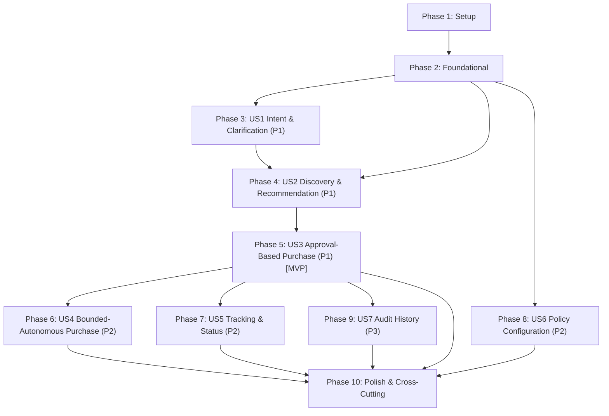

# Tasks: Acquira AI Shopping Agent

**Feature Directory**: `specs/001-ai-shopping-agent`  
**Date**: 2026-11-01  
**Status**: Task Generation Complete — Implementation Pending Explicit User Approval  
**Prerequisites**: [`plan.md`](file:///D:/Learnings/Major_Projects/Acquira/specs/001-ai-shopping-agent/plan.md), [`spec.md`](file:///D:/Learnings/Major_Projects/Acquira/specs/001-ai-shopping-agent/spec.md), [`research.md`](file:///D:/Learnings/Major_Projects/Acquira/specs/001-ai-shopping-agent/research.md), [`data-model.md`](file:///D:/Learnings/Major_Projects/Acquira/specs/001-ai-shopping-agent/data-model.md), [`quickstart.md`](file:///D:/Learnings/Major_Projects/Acquira/specs/001-ai-shopping-agent/quickstart.md), [`contracts/`](file:///D:/Learnings/Major_Projects/Acquira/specs/001-ai-shopping-agent/contracts/)

> [!IMPORTANT]
> **Implementation Authorization Boundary**: Task generation and dependency ordering are complete for planning and review. Implementation has **NOT** been authorized and must not begin until formal user approval is granted.

---

## Format: `- [ ] [TaskID] [P?] [Story?] Description with file path`

- **[P]**: Parallelizable task (independent file, no blocking prerequisites).
- **[Story]**: User story identifier (`[US1]` through `[US7]`). Omitted for Setup, Foundational, and Polish phases.
- Exact file paths are specified for every task.

---

## Phase 1: Setup (Shared Infrastructure)

**Purpose**: Multi-service repository initialization, container orchestration, styling design tokens, and test tooling.

- [ ] T001 Create initial repository workspace layout and base orchestration skeleton in `docker-compose.yml` (declaring top-level version, shared networks, volume definitions, and service stubs), `.env.example` (template environment variables with zero secrets), `web/`, `ai-service/`, and `config/`
- [ ] T002 [P] Initialize Python FastAPI service in `ai-service/pyproject.toml` and `ai-service/Dockerfile` with dependencies (FastAPI, Uvicorn, Pydantic v2, pytest, httpx)
- [ ] T003 [P] Initialize Next.js 15+ App Router web service in `web/package.json`, `web/tsconfig.json`, and `web/Dockerfile` with React 19, TypeScript, and motion/react
- [ ] T004 [P] Configure editorial styling foundation in `web/tailwind.config.ts` and `web/src/app/globals.css` with warm stone `#F9F8F6`, deep charcoal `#1A1A1A`, terracotta accent `#9E5A38`, and initialize `web/src/components/ui/`
- [ ] T005 [P] Configure Vitest test runner in `web/vitest.config.ts` and pytest configuration in `ai-service/pyproject.toml`

---

## Phase 2: Foundational (Blocking Prerequisites)

**Purpose**: Core infrastructure, database schemas, authentication, capability registry, and audit logging that MUST be complete before any user story can be implemented.

> **CRITICAL**: No user story implementation may begin until this phase is fully complete and verified.

- [ ] T006 Configure dedicated PostgreSQL 16 service in `docker-compose.yml` under `db` service definition (image `postgres:16-alpine`, port mapping `5432:5432`, persistent volume `postgres_data`, `pg_isready` healthcheck, and DB credentials wired from `.env`); depends on T001
- [ ] T007 [P] Configure Drizzle ORM client and connection pool in `web/src/lib/db/index.ts` with environment variable validation
- [ ] T008 [P] Define `users` table schema in `web/src/lib/db/schema/users.ts` with verbatim constraints: `id UUID PRIMARY KEY DEFAULT gen_random_uuid()`, `email VARCHAR(255) NOT NULL UNIQUE`, `display_name VARCHAR(100) NOT NULL`, `password_hash VARCHAR(255) NOT NULL`, `is_anonymized BOOLEAN NOT NULL DEFAULT FALSE`, `created_at TIMESTAMPTZ NOT NULL DEFAULT NOW()`, `updated_at TIMESTAMPTZ NOT NULL DEFAULT NOW()`, `deleted_at TIMESTAMPTZ NULL`
- [ ] T009 [P] Define `shopping_sessions` schema in `web/src/lib/db/schema/sessions.ts` with verbatim constraints: `id UUID PRIMARY KEY DEFAULT gen_random_uuid()`, `user_id UUID NOT NULL REFERENCES users(id) ON DELETE CASCADE`, `title VARCHAR(255) NOT NULL`, `created_at TIMESTAMPTZ NOT NULL DEFAULT NOW()`, `updated_at TIMESTAMPTZ NOT NULL DEFAULT NOW()`; ensure `audit_events.session_id` uses `ON DELETE SET NULL` and `users` table uses soft-delete anonymization (`is_anonymized: TRUE`) so session purging or account anonymization never cascade-deletes financial transactions or audit trails protected under `ON DELETE RESTRICT`
- [ ] T010 [P] Define `audit_events` schema in `web/src/lib/db/schema/audit.ts` with verbatim constraints: `id UUID PRIMARY KEY DEFAULT gen_random_uuid()`, `user_id UUID NOT NULL REFERENCES users(id) ON DELETE RESTRICT`, `session_id UUID NULL REFERENCES shopping_sessions(id) ON DELETE SET NULL`, `action_type VARCHAR(50) NOT NULL` (supporting 'SEARCH_INITIATED', 'POLICY_EVALUATED', 'ORDER_AUTHORIZED', 'PAYMENT_AUTHORIZED', 'PAYMENT_CAPTURED', 'PAYMENT_DECLINED', 'PAYMENT_RECONCILED', 'SIMULATED_DEMO', 'PRIVILEGED_ACCESS'), `action_inputs_sanitized JSONB NOT NULL`, `action_outcome VARCHAR(50) NOT NULL`, `policy_decision_notes TEXT NULL`, `access_justification_case_id VARCHAR(100) NULL`, `created_at TIMESTAMPTZ NOT NULL DEFAULT NOW()`, plus indexes `(user_id, created_at)` and `(action_type, created_at)`
- [ ] T011 Setup session authentication and secure `httpOnly` cookie handling in `web/src/lib/auth/session.ts` with route protection middleware in `web/src/middleware.ts`
- [ ] T012 [P] Implement Capability Registry loader and validator in `web/src/lib/marketplace/registry.ts` validating marketplace and payment providers ('mock_payment_gateway', prospective 'phonepe_pg', prospective 'amazon_pay', and deferred 'cbdc_pilot') in `config/capability-registry.json` against `config/capability-registry.schema.json`
- [ ] T013 [P] Implement Privacy-Preserving Audit Logger in `web/src/lib/audit/logger.ts` with regex scrubbers for email, phone numbers, payment card numbers, UPI VPAs, PINs, and OTPs before database insertion into `audit_events`
- [ ] T014 Generate and run initial database migrations using Drizzle Kit in `web/src/lib/db/migrations/` ensuring strictly ordered schema creation: referenced parent tables `users` and `shopping_sessions` created before dependent tables (`audit_events` with `session_id ON DELETE SET NULL`; and subsequent story tables `transactions` before `payments` with `transaction_id UNIQUE REFERENCES transactions(id) ON DELETE RESTRICT`), and verify connectivity across containers

**Checkpoint**: Shared foundation ready. User story implementation can now begin.

---

## Phase 3: User Story 1 — Natural-Language Product Request and Clarification (Priority: P1)

**Goal**: Extract shopping requirements from English and Roman-script Hinglish text; identify missing, ambiguous, or contradictory constraints; ask targeted clarification questions.

**Independent Test**: Submit natural language queries to `/extract-requirements` and verify structured output or targeted clarification questions (Quickstart Scenario 1).

### Tests for User Story 1
- [ ] T015 [P] [US1] Create unit test suite for intent and specification parser in `ai-service/tests/unit/test_extractor.py` covering clear requests, ambiguous requests, contradictory constraints (e.g. OLED under ₹10,000), and Roman-script Hinglish handling (Quickstart Scenario 1)

### Implementation for User Story 1
- [ ] T016 [P] [US1] Define `product_requests` table schema in `web/src/lib/db/schema/product_requests.ts` with verbatim constraints: `id UUID PRIMARY KEY DEFAULT gen_random_uuid()`, `session_id UUID NOT NULL REFERENCES shopping_sessions(id) ON DELETE CASCADE`, `raw_query TEXT NOT NULL`, `extracted_category VARCHAR(100) NOT NULL`, `extracted_budget_max_inr NUMERIC(12, 2) NULL`, `extracted_specifications JSONB NOT NULL DEFAULT '{}'::jsonb`, `user_preferences JSONB NOT NULL DEFAULT '{}'::jsonb`, `is_resolved BOOLEAN NOT NULL DEFAULT FALSE`, `created_at TIMESTAMPTZ NOT NULL DEFAULT NOW()`; verify that conversational request cleanup does not cascade to or compromise immutable audit records
- [ ] T017 [P] [US1] Implement Pydantic models for requirement extraction in `ai-service/app/models/extraction.py` mirroring OpenAPI contract `/extract-requirements` in `contracts/ai-service-api.yaml`
- [ ] T018 [US1] Implement intent extraction service in `ai-service/app/services/extractor.py` supporting English and Roman-script Hinglish parsing, constraint contradiction detection, and targeted clarification question generation
- [ ] T019 [US1] Implement FastAPI endpoint `POST /extract-requirements` in `ai-service/app/api/extraction.py` with standard `ErrorResponse` schemas and register router in `ai-service/app/main.py`
- [ ] T020 [P] [US1] Implement typed AI HTTP client in `web/src/lib/ai-client/extractor-client.ts` with Zod schema validation and error fallback
- [ ] T021 [US1] Implement conversational chat route handler in `web/src/app/api/chat/route.ts` orchestrating session creation, intent extraction, clarification prompting, and persistence in `product_requests`
- [ ] T022 [US1] Build conversational chat UI component in `web/src/components/chat/ChatInterface.tsx` and integrate into `web/src/app/session/[id]/page.tsx` with editorial styling, message history, and reduced-motion support

**Checkpoint**: User Story 1 functional. Natural language requests are parsed, clarified, and resolved conversationally.

---

## Phase 4: User Story 2 — Marketplace Discovery, Comparison, and Explainable Recommendation (Priority: P1)

**Goal**: Discover candidate products from verified sources, normalize itemized costs (`base_price_inr`, `shipping`, `taxes`, `platform_fees`), mark lower bounds for `UNAVAILABLE` costs, rank options, and present transparent trade-off explanations.

**Independent Test**: Pass candidate offers through normalizer and ranker, verifying itemized costs, missing cost disclosures, data freshness, and trade-off synthesis (Quickstart Scenario 2).

### Tests for User Story 2
- [ ] T023 [P] [US2] Create unit test suite for itemized cost normalizer and ranker in `ai-service/tests/unit/test_normalizer_costs.py` covering the non-zero rule for unknown costs, lower-bound flagging, and staleness threshold detection (Quickstart Scenario 2)

### Implementation for User Story 2
- [ ] T024 [P] [US2] Define `recommendation_sets` schema in `web/src/lib/db/schema/recommendation_sets.ts` with verbatim constraints: `id UUID PRIMARY KEY DEFAULT gen_random_uuid()`, `request_id UUID NOT NULL REFERENCES product_requests(id) ON DELETE CASCADE`, `ranking_rationale TEXT NOT NULL`, `trade_offs_summary TEXT NOT NULL`, `data_quality_disclosures JSONB NOT NULL DEFAULT '[]'::jsonb`, `data_freshness_at TIMESTAMPTZ NOT NULL`, `is_stale BOOLEAN NOT NULL DEFAULT FALSE`, `created_at TIMESTAMPTZ NOT NULL DEFAULT NOW()`; ensure recommendation sets preserve data freshness history and ranking evidence for dispute resolution, preserving deferred retention policies (DEP-004, DEP-006) pending legal/security review
- [ ] T025 [P] [US2] Define `product_candidates` schema in `web/src/lib/db/schema/product_candidates.ts` with verbatim constraints: `id UUID PRIMARY KEY DEFAULT gen_random_uuid()`, `recommendation_set_id UUID NOT NULL REFERENCES recommendation_sets(id) ON DELETE CASCADE`, `provider_id VARCHAR(50) NOT NULL`, `provider_item_id VARCHAR(255) NOT NULL`, `canonical_seller_id VARCHAR(100) NOT NULL`, `canonical_variant_sku VARCHAR(100) NOT NULL`, `product_title VARCHAR(500) NOT NULL`, `product_url TEXT NOT NULL`, `seller_name VARCHAR(255) NOT NULL`, `seller_rating NUMERIC(3, 2) NULL`, `base_price_inr NUMERIC(12, 2) NOT NULL`, `shipping_cost_inr NUMERIC(10, 2) NULL`, `shipping_status VARCHAR(20) NOT NULL DEFAULT 'KNOWN' CHECK (shipping_status IN ('KNOWN', 'ESTIMATED', 'UNAVAILABLE'))`, `estimated_taxes_inr NUMERIC(10, 2) NULL`, `taxes_status VARCHAR(20) NOT NULL DEFAULT 'KNOWN' CHECK (taxes_status IN ('KNOWN', 'ESTIMATED', 'UNAVAILABLE'))`, `platform_fees_inr NUMERIC(10, 2) NULL`, `platform_fees_status VARCHAR(20) NOT NULL DEFAULT 'KNOWN' CHECK (platform_fees_status IN ('KNOWN', 'ESTIMATED', 'UNAVAILABLE'))`, `total_payable_inr NUMERIC(12, 2) NOT NULL`, `has_unavailable_costs BOOLEAN NOT NULL DEFAULT FALSE`, `cost_disclosures JSONB NOT NULL DEFAULT '[]'::jsonb`, `rank_position INTEGER NOT NULL`, `is_recommended BOOLEAN NOT NULL DEFAULT FALSE`, `specifications JSONB NOT NULL DEFAULT '{}'::jsonb`, `created_at TIMESTAMPTZ NOT NULL DEFAULT NOW()`; enforce that `transactions.candidate_id ON DELETE RESTRICT` guarantees transaction-linked candidates and dispute evidence can never be hard-deleted through cascading parent deletion; distinguish cleanup so that only unreferenced candidates/sets may be pruned, while transaction evidence is preserved indefinitely under the deferred legal retention policy (DEP-004, DEP-006)
- [ ] T026 [P] [US2] Implement Pydantic models for product discovery, itemized costs, and ranking in `ai-service/app/models/discovery.py` mirroring OpenAPI contract `/discover-and-rank` in `contracts/ai-service-api.yaml`
- [ ] T027 [US2] Implement product normalizer in `ai-service/app/services/normalizer.py` enforcing the non-zero rule for unknown costs, computing lower-bound totals, and generating cost disclosures
- [ ] T028 [US2] Implement explainable multi-attribute ranker in `ai-service/app/services/ranker.py` synthesizing primary reasons, trade-offs, and data freshness flags
- [ ] T029 [US2] Implement FastAPI endpoint `POST /discover-and-rank` in `ai-service/app/api/discovery.py`
- [ ] T030 [P] [US2] Implement Mock Marketplace Adapter in `web/src/lib/marketplace/adapters/mock-adapter.ts` and Mock Payment Gateway in `web/src/lib/payment/adapters/mock-gateway.ts` implementing `MarketplaceAdapter` (`contracts/marketplace-adapter.ts`) and `PaymentAdapter` (`contracts/payment-adapter.ts`) for development/testing sandbox only; supporting simulated authorization, capture with `DEMO-RECEIPT-...` tokens, simulated decline, and timeout reconciliation lookup (`reconcilePayment`); explicitly gating real checkout/payment dispatch so that live external checkout is impossible unless both checkout and payment capabilities are individually verified in `config/capability-registry.json`; verify unverified or unavailable providers always route to safe handoff
- [ ] T031 [US2] Implement discovery and ranking orchestrator in `web/src/lib/marketplace/discovery-service.ts` checking capability registry, invoking search adapters, calling `ai-service`, and persisting in `recommendation_sets` and `product_candidates`
- [ ] T032 [US2] Build recommendation display and comparison drawer in `web/src/components/editorial/RecommendationCards.tsx` with itemized cost breakdowns, freshness indicators, and trade-off summaries

**Checkpoint**: User Stories 1 and 2 functional. Recommendations are generated with itemized cost breakdowns and transparent trade-offs.

---

## Phase 5: User Story 3 — Approval-Based Purchase Flow (Priority: P1) [MVP Checkpoint]

**Goal**: Present complete purchase confirmation summary, enforce price increase and decrease dual thresholds, verify canonical offer fingerprint, detect duplicates, and execute checkout or safe provider handoff.

**Independent Test**: Verify purchase summary review, price shift re-approval, offer fingerprint mismatch pause, concurrent idempotency, and fallback handoff (Quickstart Scenarios 3, 6, 7, 8).

### Tests for User Story 3
- [ ] T033 [P] [US3] Create unit tests for dual price thresholds in `web/tests/unit/price-thresholds.test.ts` verifying any increase > ₹0.00 pauses, decrease within thresholds proceeds, and decrease exceeding thresholds pauses (Quickstart Scenario 3)
- [ ] T034 [P] [US3] Create integration tests for canonical offer fingerprinting in `web/tests/integration/changed-offer-fingerprint.test.ts` verifying merchant ID or variant SKU changes at identical price halt checkout with reason `OFFER_FINGERPRINT_MISMATCH` (Quickstart Scenario 6)
- [ ] T035 [P] [US3] Create integration tests for idempotency, duplicate prevention, and retry consistency in `web/tests/integration/concurrent-idempotency.test.ts` verifying the exactly-one-order guarantee across both payment and checkout layers: concurrent in-flight requests receive 409 Conflict; completed-request retries return cached authoritative outcome without double-charging or duplicate orders, and separate keys cannot bypass 24h duplicate window (Quickstart Scenario 7)
- [ ] T036 [P] [US3] Create integration tests for ambiguous timeout reconciliation in `web/tests/integration/timeout-reconciliation.test.ts` verifying network drops during payment capture or order dispatch set `UNCERTAIN`, zero blind retries occur, and background reconciliation polls `paymentAdapter.reconcilePayment` and `adapter.reconcileCheckout` to determine authoritative truth (Quickstart Scenario 9)

### Implementation for User Story 3
- [ ] T037 [P] [US3] Define `transactions` (Order Execution) schema in `web/src/lib/db/schema/transactions.ts` with verbatim constraints: `id UUID PRIMARY KEY DEFAULT gen_random_uuid()`, `user_id UUID NOT NULL REFERENCES users(id) ON DELETE RESTRICT`, `candidate_id UUID NOT NULL REFERENCES product_candidates(id) ON DELETE RESTRICT`, `purchase_mode VARCHAR(30) NOT NULL CHECK (purchase_mode IN ('APPROVAL_BASED', 'BOUNDED_AUTONOMOUS'))`, `order_execution_mode VARCHAR(30) NOT NULL CHECK (order_execution_mode IN ('SIMULATED', 'LIVE_PROVIDER', 'MANUAL_HANDOFF'))`, `status VARCHAR(30) NOT NULL CHECK (status IN ('PENDING', 'SUBMITTED', 'CONFIRMED', 'FAILED', 'TIMED_OUT', 'UNCERTAIN'))`, `canonical_seller_id VARCHAR(100) NOT NULL`, `canonical_variant_sku VARCHAR(100) NOT NULL`, `quantity INTEGER NOT NULL DEFAULT 1 CHECK (quantity > 0)`, `authorized_baseline_inr NUMERIC(12, 2) NOT NULL`, `authorized_fingerprint VARCHAR(64) NOT NULL`, `final_charged_amount_inr NUMERIC(12, 2) NULL`, `idempotency_key VARCHAR(100) NOT NULL UNIQUE`, `provider_order_id VARCHAR(255) NULL`, `is_demo_order BOOLEAN NOT NULL DEFAULT FALSE`, `failure_reason TEXT NULL`, `reconciliation_attempts INTEGER NOT NULL DEFAULT 0`, `last_reconciled_at TIMESTAMPTZ NULL`, `created_at TIMESTAMPTZ NOT NULL DEFAULT NOW()`, `updated_at TIMESTAMPTZ NOT NULL DEFAULT NOW()`
- [ ] T038 [US3] Define `payments` and `payment_state_history` schemas in `web/src/lib/db/schema/payments.ts` and `transaction_state_history` in `web/src/lib/db/schema/transaction_history.ts` with verbatim constraints: `payments(id UUID PRIMARY KEY, transaction_id UUID NOT NULL UNIQUE REFERENCES transactions(id) ON DELETE RESTRICT, user_id UUID NOT NULL REFERENCES users(id) ON DELETE RESTRICT, payment_execution_mode VARCHAR(30) NOT NULL CHECK (payment_execution_mode IN ('SIMULATED', 'LIVE_PROVIDER', 'MANUAL_HANDOFF')), payment_method VARCHAR(50) NOT NULL CHECK (payment_method IN ('UPI_PHONEPE', 'AMAZON_PAY', 'MOCK_SANDBOX')), provider_id VARCHAR(50) NOT NULL, status VARCHAR(30) NOT NULL CHECK (status IN ('INITIATED', 'PENDING', 'AUTHORIZED', 'CAPTURED', 'FAILED', 'UNCERTAIN')), amount_inr NUMERIC(12, 2) NOT NULL CHECK (amount_inr > 0), idempotency_key VARCHAR(100) NOT NULL UNIQUE, provider_payment_id VARCHAR(255) NULL, is_demo_receipt BOOLEAN NOT NULL DEFAULT FALSE)`; all state histories preserved under `ON DELETE RESTRICT`; depends on T037 (`transactions` table schema); note: CBDC is deferred to future extension per Constitution A-004
- [ ] T039 [P] [US3] Implement Canonical Offer Fingerprint generator in `web/src/lib/policy/fingerprint.ts` strictly using formula: `SHA-256(${encodeURIComponent(provider_id.trim())}:${encodeURIComponent(canonical_seller_id.trim())}:${encodeURIComponent(canonical_variant_sku.trim())}:${quantity})`
- [ ] T040 [P] [US3] Implement Dual Price Threshold Evaluator in `web/src/lib/policy/price-thresholds.ts` enforcing any increase > ₹0.00 pauses, and dual percentage/absolute INR threshold evaluation on price decreases
- [ ] T041 [P] [US3] Implement 24-hour duplicate transaction detector in `web/src/lib/policy/duplicate-check.ts` querying existing `PENDING`, `SUBMITTED`, or `CONFIRMED` transactions for identical user, candidate, seller, and quantity
- [ ] T042 [P] [US3] Implement Safe Provider Handoff generator in `web/src/lib/marketplace/handoff.ts` and Safe Payment Handoff in `web/src/lib/payment/payment-handoff.ts` formatting deep-links, dynamic UPI Intent URLs (`upi://pay?...`), QR payloads, last observed itemized costs, and manual checklists when live checkout or prospective payment is unverified or unavailable (e.g. PhonePe UPI, Amazon Pay; note: CBDC is outside MVP scope)
- [ ] T043 [US3] Implement deterministic Checkout & Payment Service in `web/src/lib/checkout/checkout-service.ts` and `web/src/lib/payment/payment-service.ts` opening PostgreSQL transaction with `SELECT ... FOR UPDATE` on `idempotency_key`: enforcing cross-execution mode barrier (SIMULATED payment can NEVER authorize a LIVE_PROVIDER order), verifying payment capture before order dispatch, re-evaluating price baseline and offer fingerprint via `adapter.getOfferDetails`, gating real execution behind capability registry, and recording state histories
- [ ] T044 [US3] Implement background timeout reconciliation worker in `web/src/lib/checkout/reconciliation.ts` querying `UNCERTAIN` payments and orders and invoking `paymentAdapter.reconcilePayment` and `adapter.reconcileCheckout` without blind retries
- [ ] T045 [US3] Implement checkout API route handler in `web/src/app/api/checkout/route.ts` handling purchase authorization and payment execution requests: distinguishing `SIMULATED`, `LIVE_PROVIDER`, and `MANUAL_HANDOFF`, returning 409 Conflict on concurrent in-flight duplicates, returning cached authoritative results on completed retries, and returning structured `SafeHandoffDetails` / `SafePaymentHandoffDetails` for unverified providers
- [ ] T046 [US3] Build Purchase Summary and Payment Modal in `web/src/components/purchasing/PurchaseSummaryModal.tsx` displaying clear execution mode badge (`SIMULATED DEMO` vs `LIVE`), payment method selector ('PhonePe UPI' [prospective/handoff], 'Amazon Pay' [prospective/handoff], 'Mock Sandbox' [simulated demo]), itemized costs, price difference alerts, offer change disclosures, and confirmation triggers (note: CBDC is excluded from selectable MVP options per Constitution A-004)

**Checkpoint**: Core MVP complete. User Stories 1, 2, and 3 provide an end-to-end verified shopping and approval-based purchase flow.

---

## Phase 6: User Story 4 — Bounded-Autonomous Purchase Flow (Priority: P2)

**Goal**: Enable hands-off purchases only when the 5 mandatory conditions are satisfied, enforcing per-order spending limits, optional cumulative period limits, dual price thresholds, and immediate pause on price increases or offer substitutions.

**Independent Test**: Verify autonomous activation gate, spending limit enforcement, cumulative budget pause, and price-decrease threshold evaluation (Quickstart Scenarios 4, 5).

### Tests for User Story 4
- [ ] T047 [P] [US4] Create unit test suite for per-order and cumulative spending limits in `web/tests/unit/spending-limits.test.ts` (Quickstart Scenario 4)
- [ ] T048 [P] [US4] Create integration test suite for cumulative period spending limits in `web/tests/integration/cumulative-spending.test.ts` covering daily, weekly, and monthly window budget ceiling enforcement (Quickstart Scenario 5)

### Implementation for User Story 4
- [ ] T049 [P] [US4] Implement spending limit evaluator in `web/src/lib/policy/spending-limits.ts` checking `candidate_payable <= per_order_limit_inr` and optional `current_period_spend + candidate_payable <= cumulative_period_limit_inr`
- [ ] T050 [US4] Implement Bounded-Autonomous Policy Gate in `web/src/lib/policy/autonomous-gate.ts` verifying all 5 prerequisites: (1) `is_autonomous_enabled` is true, (2) `per_order_limit_inr` is non-null and > 0, (3) policy category/marketplace matches, (4) `price_change_percentage_threshold` is non-null and >= 0 (explicit 0 is valid; missing/null is rejected), (5) `price_change_absolute_threshold_inr` is non-null and >= 0 (explicit 0 is valid; missing/null is rejected), plus rejecting any candidate with `UNAVAILABLE` cost components (FR-024)
- [ ] T051 [US4] Implement Autonomous Checkout Orchestrator in `web/src/lib/checkout/autonomous-service.ts` linking policy gate to payment and checkout services, enforcing capability registry verification before execution, establishing pre-checkout evaluated order total baseline, detecting price shifts/fingerprint mismatches, and dispatching post-purchase notifications
- [ ] T052 [US4] Build autonomous purchase status notification banners in `web/src/components/purchasing/AutonomousNotification.tsx` and integrate into conversational feed

**Checkpoint**: User Story 4 functional. Bounded-autonomous purchasing executes safely behind deterministic policy gates.

---

## Phase 7: User Story 5 — Transaction Status and Order Tracking (Priority: P2)

**Goal**: Track confirmed orders via verified provider tracking API or provide direct carrier/marketplace tracking deep-links.

**Independent Test**: Query tracking endpoint for verified and unverified mock providers, verifying freshness timestamps and fallback URLs.

### Implementation for User Story 5
- [ ] T053 [P] [US5] Implement order tracking service in `web/src/lib/marketplace/tracking-service.ts` inspecting `config/capability-registry.json` for verified `tracking` capability, invoking `adapter.trackOrder(providerOrderId)`, and generating tracking link fallbacks when unavailable
- [ ] T054 [US5] Implement order status API route in `web/src/app/api/tracking/[orderId]/route.ts` returning normalized tracking events, data freshness timestamps, and carrier URLs
- [ ] T055 [US5] Build Order Tracking Card and modal in `web/src/components/purchasing/OrderTrackingCard.tsx` displaying status timeline (`ORDER_PLACED`, `DISPATCHED`, `IN_TRANSIT`, `DELIVERED`, `CANCELLED`, `UNKNOWN`) and delivery estimates

**Checkpoint**: User Story 5 functional. Post-purchase transparency delivered through integrated tracking and fallback deep-links.

---

## Phase 8: User Story 6 — User Preferences and Purchasing Policy Configuration (Priority: P2)

**Goal**: Manage persistent user preferences, configure autonomous mode limits/thresholds, and support GDPR/DPDP right-to-be-forgotten soft-deletion.

**Independent Test**: Configure policies in settings, toggle autonomous mode, verify 5-gate validation, and test account anonymization while preserving transaction history.

### Implementation for User Story 6
- [ ] T056 [P] [US6] Define `purchasing_policies` schema in `web/src/lib/db/schema/policies.ts` with verbatim constraints: `id UUID PRIMARY KEY DEFAULT gen_random_uuid()`, `user_id UUID NOT NULL UNIQUE REFERENCES users(id) ON DELETE CASCADE`, `is_autonomous_enabled BOOLEAN NOT NULL DEFAULT FALSE`, `per_order_limit_inr NUMERIC(12, 2) NULL CHECK (per_order_limit_inr > 0)`, `cumulative_period_type VARCHAR(20) NULL CHECK (cumulative_period_type IN ('DAILY', 'WEEKLY', 'MONTHLY'))`, `cumulative_period_limit_inr NUMERIC(12, 2) NULL CHECK (cumulative_period_limit_inr > 0)`, `price_change_percentage_threshold NUMERIC(5, 2) NULL CHECK (price_change_percentage_threshold >= 0)`, `price_change_absolute_threshold_inr NUMERIC(10, 2) NULL CHECK (price_change_absolute_threshold_inr >= 0)`, `approved_categories JSONB NOT NULL DEFAULT '[]'::jsonb`, `approved_marketplaces JSONB NOT NULL DEFAULT '[]'::jsonb`, `seller_constraints JSONB NOT NULL DEFAULT '{}'::jsonb`, `preferred_payment_methods JSONB NOT NULL DEFAULT '[]'::jsonb` (supporting 'UPI_PHONEPE', 'AMAZON_PAY', 'MOCK_SANDBOX'; CBDC deferred to future extension), `updated_at TIMESTAMPTZ NOT NULL DEFAULT NOW()`
- [ ] T057 [US6] Implement settings API routes in `web/src/app/api/settings/policy/route.ts` validating mandatory `per_order_limit_inr` (> 0), non-null `price_change_percentage_threshold` (>= 0), and non-null `price_change_absolute_threshold_inr` (>= 0) before enabling autonomous mode, rejecting missing/null values with zero system defaults
- [ ] T058 [US6] Implement Account Deletion & Soft-Delete Anonymization in `web/src/app/api/settings/account/route.ts` setting `is_anonymized = true`, hashing email/name, setting `deleted_at = NOW()`, and leaving `transactions`, `payments`, `transaction_state_history`, `payment_state_history`, and `audit_events` intact under `ON DELETE RESTRICT`
- [ ] T059 [US6] Build Policy Settings View in `web/src/app/settings/page.tsx` with editorial sliders and inputs for spending limits, dual thresholds, approved categories, and autonomous mode toggle

**Checkpoint**: User Story 6 functional. User preferences and autonomous guardrails are configurable and auditable.

---

## Phase 9: User Story 7 — Audit History and Transparency (Priority: P3)

**Goal**: Provide plain-language audit trail of all consequential agent decisions, PII masking, and privileged operator access control.

**Independent Test**: Query audit history for logged actions, verify PII scrubbing, and assert 403 Forbidden for operator queries lacking case justification tokens (Quickstart Scenario 9).

### Tests for User Story 7
- [ ] T060 [P] [US7] Create integration test suite for audit logging and access control in `web/tests/integration/audit-logging.test.ts` covering user history retrieval, PII scrubbing, and operator 403 Forbidden without case ID (Quickstart Scenario 9)

### Implementation for User Story 7
- [ ] T061 [US7] Implement audit log query service in `web/src/lib/audit/query-service.ts` retrieving user events, translating technical codes into plain-language sentences, and enforcing privileged case-id authorization for operators
- [ ] T062 [US7] Implement audit history API route in `web/src/app/api/audit-logs/route.ts` with pagination and date filters
- [ ] T063 [US7] Build Audit History View in `web/src/app/history/page.tsx` displaying timeline of searches, recommendations, policy evaluations, authorizations, and transactions with plain-language explanations

**Checkpoint**: User Story 7 functional. Complete transparency and auditability delivered.

---

## Phase 10: Polish & Cross-Cutting Concerns

**Purpose**: Global error handling, accessibility compliance, end-to-end integration verification, and quickstart validation.

- [ ] T064 [P] Implement global error handling, toast notifications, and accessible alert banners in `web/src/components/ui/AlertNotification.tsx`
- [ ] T065 [P] Verify accessibility conformance (WCAG 2.1 AA keyboard navigation, screen-reader aria tags, color contrast `#1A1A1A` on `#F9F8F6`, and `prefers-reduced-motion`) across all components in `web/src/components/`
- [ ] T066 [P] Implement end-to-end smoke test suite in `web/tests/e2e/shopping-journey.spec.ts` using Playwright verifying: (1) simulated payment and order confirmation with synthetic receipts (`DEMO-RECEIPT-...`), (2) simulated decline handling, (3) provider capability check routing prospective/unverified providers (PhonePe, Amazon Pay, Amazon, Flipkart) to Safe Handoff without live payment dispatch, (4) strict exclusion of out-of-scope methods (CBDC) from active payment execution per Constitution A-004, and (5) strict proof that simulated operations never invoke real payment or checkout capabilities
- [ ] T067 Execute complete verification guide in `specs/001-ai-shopping-agent/quickstart.md` validating Docker Compose multi-service boot, database migrations, and all 11 test scenarios

---

## Dependencies & Execution Order

### Phase Dependencies



- **Phase 1 (Setup)**: Can start immediately once implementation is authorized. No external prerequisites.
- **Phase 2 (Foundational)**: Depends on Phase 1 completion (specifically T006 PostgreSQL container configuration builds on T001 Compose skeleton). **Blocks all User Stories**.
- **Phase 3 (US1)**: Depends on Phase 2.
- **Phase 4 (US2)**: Depends on Phase 2 and US1 requirement models.
- **Phase 5 (US3 - MVP)**: Depends on Phase 2 and US2 candidate models. Completes core MVP.
- **Phases 6–9 (US4–US7)**: Depend on Foundational (Phase 2) and Core Checkout (Phase 5). Can proceed in parallel or prioritized sequence.
- **Phase 10 (Polish)**: Runs after desired user stories are completed.

---

## Parallel Opportunities by Phase

```bash
# Phase 1: Setup
T001 (workspace skeleton) runs first. Then in parallel:
T002 (ai-service Dockerfile) & T003 (web package.json) & T004 (styling tokens) & T005 (test runners)

# Phase 2: Foundational
T006 (PostgreSQL container) runs first (depends on T001). Then in parallel:
T007 (Drizzle client) & T008 (users schema) & T009 (sessions schema) & T010 (audit schema) & T012 (registry loader) & T013 (audit logger)
Followed by T011 (auth) and T014 (ordered migrations).

# Phase 3: User Story 1
T015 (extractor unit tests) & T016 (product_requests schema) & T017 (extraction Pydantic models) & T020 (AI client)

# Phase 4: User Story 2
T023 (normalizer unit tests) & T024 (recommendation_sets schema) & T025 (product_candidates schema) & T026 (discovery models) & T030 (mock adapter)

# Phase 5: User Story 3
# Independent tests, policy components, and order execution schema:
T033 (price thresholds tests) & T034 (fingerprint tests) & T035 (idempotency tests) & T036 (timeout tests) & T037 (transactions schema) & T039 (fingerprint generator) & T040 (threshold evaluator) & T041 (duplicate checker) & T042 (handoff generator)

# Payment schema and state history (strictly depends on T037 transactions table):
T038 (payments & state history schemas) follows T037

# Phase 6: User Story 4
T047 (spending limits tests) & T048 (cumulative spending tests) & T049 (limit evaluator)

# Phase 8: User Story 6
T056 (purchasing_policies schema)

# Phase 9: User Story 7
T060 (audit logging integration tests)

# Phase 10: Polish
T064 (alert notification) & T065 (a11y review) & T066 (Playwright e2e)
```

---

## Implementation Strategy & MVP Milestone

### MVP Scope (Phases 1–5)
1. Complete **Phase 1 (Setup)**: Docker Compose, Next.js, FastAPI, test harnesses.
2. Complete **Phase 2 (Foundational)**: PostgreSQL schema, authentication, capability registry, audit logging.
3. Complete **Phase 3 (User Story 1)**: Conversational intent parser and clarification questions.
4. Complete **Phase 4 (User Story 2)**: Multi-source discovery, itemized cost normalizer (`base + shipping + taxes + fees`), and explainable recommendation card drawer.
5. Complete **Phase 5 (User Story 3)**: Approval-based purchase summary, dual threshold price check, canonical fingerprint verification, concurrent idempotency, mock payment gateway (`SIMULATED`), and safe provider handoff.
6. **STOP & VALIDATE**: Run Quickstart Scenarios 1, 2, 3, 6, 7, 8 to verify complete MVP operation.

### Incremental Feature Additions
- **Increment 2**: User Story 4 (Bounded-Autonomous Mode) + User Story 6 (Settings & Spending Limits) — Quickstart Scenarios 4, 5.
- **Increment 3**: User Story 5 (Order Tracking) + User Story 7 (Audit History & Operator Access) — Quickstart Scenario 11.
- **Increment 4**: Phase 10 Polish, WCAG 2.1 AA accessibility audit, Playwright end-to-end journey (Quickstart Scenario 10 & 11).
